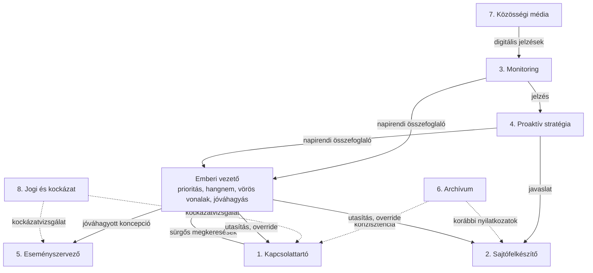

# A sajtóiroda működési modellje

A rendszer hierarchikus, de nem merev. Az élő emberi vezető a stratégiai központ: ő határozza meg a prioritásokat, a hangnemet és a „vörös vonalakat”, és ő dönt a legfontosabb megszólalásokról. Az AI-ügynökök végrehajtó és elemző szerepet töltenek be, folyamatos visszacsatolással.

## 1. Napi ciklus

1. Reggel a Monitoring Ügynök és a Proaktív Stratégia Ügynök közösen napirendi összefoglalót készít a vezetőnek.
2. A Kapcsolattartó Ügynök jelzi a beérkezett sürgős megkereséseket.
3. A vezető 15–30 perc alatt rangsorolja a teendőket, és utasításokat ad.

## 2. Feladatkiosztás és együttműködés

Az ügynökök egymás között is kommunikálnak:

- a Monitoring Ügynök jelzése alapján a Proaktív Ügynök javaslatot tesz,
- a Felkészítő Ügynök azonnal elkezdi a Q&A anyagot,
- az Eseményszervező csak akkor lép, ha a vezető jóváhagyta a koncepciót.

## 3. Emberi kontrollpontok

- Minden kimenő válasz, nyilatkozat és meghívó a vezető (vagy az általa kijelölt helyettes) jóváhagyásával megy ki.
- A rendszer naplózza, melyik ügynök milyen javaslatot tett, és rögzíti a vezető döntését is. Ez a későbbi tanulás és audit alapja.
- A vezető bármikor „override” parancsot adhat, vagy ideiglenesen kikapcsolhat bizonyos ügynököket.

## 4. Heti és havi ritmus

- **Hetente** stratégiai áttekintés: mely üzenetek működtek, hol volt rés a kommunikációban, milyen új témák merültek fel.
- **Havonta** a vezető értékeli az ügynökök teljesítményét (pontosság, hasznosság, hangnem-illeszkedés), és finomhangolja a paramétereket.

## 5. Skálázhatóság és specializáció

Amikor a konkrét szakmai terület (például egészségügy, energia, közigazgatás, tech) ismertté válik, az ügynökök promptjai és tudásbázisa specializálható. Az általános struktúra azonban már most stabil keretet ad.
