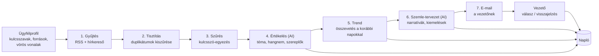

# A Monitoring Ügynök prototípusának terve

*Állapot: **jóváhagyásra vár** (2026-10-29). Amíg a tulajdonos nem hagyja jóvá, kód nem készül.*

## 1. A cél egy mondatban

Egy ügyfélszervezet számára minden reggel egy értelmező sajtószemle érkezik a vezetőjének e-mailben, a megadott kulcsszavak alapján, hangnemelemzéssel és trendjelzéssel; a vezető válaszban jelezheti, mi volt hasznos, és minden javaslat és döntés naplóba kerül.

A prototípus **kifelé semmit nem kommunikál**. Az egyetlen kimenő levél a vezetőnek szóló belső jelentés. Az alapszabály (kimenő üzenet csak jóváhagyással) így érintetlen marad, mert a Monitoring Ügynök szerepe eleve belső (`agents/03-monitoring.yaml`).

## 2. Mi van a prototípusban, és mi nincs

| Benne van | Később |
|-----------|--------|
| Napi sajtószemle e-mailben | Heti „media pulse” jelentés |
| Kulcsszavas gyűjtés RSS-ből és hírkereső-csatornákból | Fizetős médiafigyelő adatbázis |
| Cikkenkénti besorolás: téma, hangnem, érintett szereplők | Közösségi média (a 7. ügynök feladata) |
| Narratívák, kiemelt médiumok a napi összefoglalóban | Versenytárs-összehasonlító elemzés |
| Trendjelzés (hirtelen felerősödő téma) azonnali értesítéssel | Átadás a Proaktív Ügynöknek |
| Több, egymástól elválasztott ügyfél (tenant) | Csevegőfelület (az e-mail az első felület) |
| Válaszban adott visszajelzés, napló | Webes irányítópult |

Az összehasonlító elemzés és a media pulse a specifikációban szerepel, de a prototípus célja az, hogy a napi ciklus **megbízhatóan** működjön. A látványosabb kimenetek erre épülnek.

## 3. Hogyan működik (a napi ciklus)



**Egy példa a kimenetre.** Tegyük fel, hogy az ügyfél egy regionális kórházhálózat, a kulcsszavak a „Dél-Dunántúli Kórházak”, az „ápolóhiány” és a vezérigazgató neve. A reggeli levél így kezdődne:

> *Tegnap 14 cikk érintette a szervezetet, ebből 9 az ápolóhiány-vitához kapcsolódott. A hangnem többségében negatív (9 negatív, 3 semleges, 2 pozitív), de a negatív cikkek zöme egy országos hírportál közös forrására megy vissza. **Figyelem:** az „ápolóhiány” említése a megelőző hét átlagának háromszorosa, a téma 18 órától gyorsul. Három cikk neveként említi a vezérigazgatót; ezek listája lent.*

Ezt követi a cikkek rövid listája (cím, médium, hangnem, egymondatos indoklás, hivatkozás), a „mire érdemes figyelni” és a „lehetőség” rovat, végül egy sor, amely jelzi, hogy a szöveget AI készítette elő.

## 4. A megoldás felépítése

### 4.1 Javasolt technológia

Az irány (az eredeti javaslat; a végleges választás a 7. fejezet 1. pontja szerint eldöntetlen, a 4.8 szabályai bármelyik esetén érvényesek): **Cloudflare Workers + D1 adatbázis + Claude API**.

- A manyai.hu már Cloudflare-en fut, a sajtófigyelő kódja (`functions/api/press.js`) pedig ugyanilyen környezetre készült. A feed-lekérő és -értelmező részei (`load`, `loadAny`, `parse`, `decode`) átemelhetők.
- Az időzítést (reggeli futás, óránkénti trendellenőrzés) a Cloudflare saját ütemezője végzi; külön szerver nem kell.
- A D1 egy kis, olcsó adatbázis, tenant-azonosítóval: ebben van az ügyfélprofil, a cikk, az értékelés és a napló.
- A kétlépcsős AI-használat: az olcsó modell (Haiku 5.5) cikkenként besorol, a jobb (Sonnet 5.5) a napi összefoglalót írja. Így a költség a cikkszámmal nő, a minőség pedig ott van, ahol a vezető olvas.

**Alternatíva: Make-forgatókönyv.** A Make-fiókhoz már van hozzáférésünk, ezzel a bemutatható demó egy-két nap alatt kész lehet. Hátránya, hogy a több ügyfél szétválasztása, a naplózás és a verziókövetés nehézkes, és az ügyfelek felé nehezebb eladni. Ezért csak gyors bemutatónak javaslom, nem alapnak.

### 4.2 Az ügyfélprofil (a „paraméterek”)

Ügyfelenként egy fájl vagy adatbázis-rekord, amelyet a **tulajdonos és az ügyfél vezetője** közösen állít be. A szakmai területet az ügyfél határozza meg, ezért itt él minden, ami területfüggő:

```yaml
ugyfel: delddunantuli-korhazak
vezeto_email: ...            # csak ide megy levél
nyelv: hu
foldrajzi_hatokor: [HU, Dél-Dunántúl]
kulcsszavak:
  szervezet: ["Dél-Dunántúli Kórházak", "DDK"]
  szemelyek: ["<vezérigazgató neve>"]
  temak: ["ápolóhiány", "várólista", "sürgősségi ellátás"]
versenytarsak: []            # később használjuk
forrasok:
  rss: [...]
  hirkereso: ["<kulcsszavas keresések>"]
vorosvonalak:                # eszkalációs szabályok
  - "peres ügy vagy hatósági eljárás említése"
  - "haláleset a szervezet intézményében"
utemezes: { szemle: "07:30", trendellenorzes: "óránként" }
```

A „vörös vonalak” azok a témák, amelyeknél a rendszer nem vár a reggeli szemlére, hanem azonnal értesít.

### 4.3 Források: kezdetben ingyenes csatornák

1. **A manyai.hu-n már használt hat hírportál RSS-e** (Index, Telex, Infostart, 24.hu, Portfolio, Magyar Nemzet). *Fontos eltérés:* a mostani kód csatornánként csak a 6 legfrissebb címet veszi. Kulcsszavas szűréshez az egész csatornát (jellemzően 20–50 tételt) le kell kérni, és csak utána szűrni.
2. **Hírkereső RSS kulcsszavanként** (például a Google News keresési csatornája). Ez az, ami az RSS-hez képest a *kereshetőséget* adja. Működését és felhasználási feltételeit a megvalósítás elején ellenőrizni kell, mert nem garantált szolgáltatás.
3. **Ügyfél-specifikus források**: szakmai lapok, helyi médiumok, amelyeket az ügyfél vezetője megad.

Amit **nem** teszünk: nem mentjük el a cikkek teljes szövegét. Elég a cím, a bevezető részlet, a link és a médium neve. Ez szerzői jogi és tárhelyszempontból is egyszerűbb, a vezető pedig úgyis a linkre kattint.

### 4.4 Az értékelés: hogyan lesz „értelmező” a szemle

Cikkenként az AI strukturált választ ad (nem szabad szöveget): téma-címke, hangnem (pozitív / negatív / semleges), a szervezetre vonatkoztatott fontosság (1–5), érintett szereplők, és egy mondatos indoklás. A hangnem **a szervezet szemszögéből** értendő: egy cikk lehet általában semleges, miközben a szervezetre nézve kedvezőtlen.

Ebből a második lépésben készül a napi szöveg: domináns narratívák (a cikkek témák szerinti csoportosítása), kiemelt médiumok, nagy elérésű vagy gyorsan terjedő tartalom (ha az adat elérhető).

**Trendjelzés:** a téma mai említésszámát a megelőző 14 nap átlagához és szórásához hasonlítjuk. Küszöb például: átlag + 2 szórás, és legalább 5 említés. A küszöb ügyfelenként hangolható. Egy új, korábban nem látott szempont (például egy új szereplő neve a szervezet mellett) külön jelzést kap.

### 4.5 Visszajelzés e-mailben

A levél alján rövid, gépileg is értelmezhető parancsok: *„3: nem releváns”*, *„5: fontos, kérem figyelemmel kísérni”*, *„a várólista témát hagyd ki”*. A vezető válaszol, a rendszer feldolgozza és naplózza, majd a következő szemlében már figyelembe veszi. (A válasz-fogadás a 4. mérföldkő, lásd lent; addig a visszajelzés kézzel is rögzíthető.)

### 4.6 Napló

Minden esemény egy sor, tenant-azonosítóval, időbélyeggel és szereplővel: a besorolás (ügynök-javaslat), a trendjelzés, a kiküldött szemle, a vezető visszajelzése (emberi döntés), és a profil minden módosítása. A napló csak hozzáfűzhető, nem módosítható. Ebből készül majd a havi értékelés (pontosság, hasznosság), és ez az audit alapja.

### 4.7 Több ügyfél kezelése

A tervezés elejétől minden táblában ott a `tenant_id`, minden lekérdezés ezzel szűr, és az AI-nak soha nem kerül két ügyfél adata ugyanabba a kéréshez. Az 5. mérföldkő külön tesztel erre: egy második, szándékosan átfedő kulcsszavú ügyféllel ellenőrizzük, hogy semmi nem szivárog át.

### 4.8 Leválaszthatóság: motor, profil, kiadható csomag

*A tulajdonos 2026-10-29-i kérése: a megoldás bármikor csatolható legyen egy új (például az ügyfél saját) Make-hozzáféréshez, ha az ügyfél felhasználási jogot kap, a saját területéhez igazíthatja, és leválasztható.*

Ez a tervezési szabály **a platformtól független**, ezért érvényes akár Make, akár Cloudflare lesz a motor:

1. **A motor általános.** Nincs benne ügyfélre, szakterületre vagy személyre utaló szó.
2. **Minden ügyfélfüggő dolog a profilban van** (`monitoring/profil-sablon.yaml`): kulcsszavak, források, vörös vonalak, címzett, ütemezés, megőrzés. Az ügyfél ezt szerkesztheti, és ez költözik vele.
3. **Az utasítások (promptok) külön fájlokban vannak** (`monitoring/prompts/`), a profilból kitöltött változókkal. Így az ügyfél a saját szakterületéhez igazíthatja a szövegezést a motor átépítése nélkül.
4. **A napló sémája rögzített és tenant-szerint exportálható** (`monitoring/naplo-sema.md`).
5. **Titok nem kerül a profilba vagy a repóba.** A hozzáférések (levelezés, AI-kulcs) a motor kapcsolataiban élnek, és minden példány a *saját* kapcsolatait használja. A Make blueprint-exportja sem viszi magával a kapcsolatokat.
6. **Kiadható csomag = motor + profilsablon + promptok + naplóséma + telepítési útmutató.** Ez verziókövetve van a repóban (Make esetén a blueprint-fájl a `make/` mappába kerülne).

Két üzemmód: (a) **üzemeltetett**: Ön futtatja, ügyfelenként külön mappában/csapatban/profilban; (b) **leválasztott**: az ügyfél a saját fiókjába telepíti, saját kapcsolatokkal.

*Szerződési oldal (nem műszaki, jogász bevonásával rendezendő):* mit kap az ügyfél (használat, módosítás, továbbadás), mi marad a tulajdonosnál, és a platform (Make) felhasználási feltételei megengedik-e az átadást.

## 5. A nyitott kérdések (4–9.) rövid válasza erre a prototípusra

| # | Kérdés | Javaslat a prototípushoz |
|---|--------|--------------------------|
| 4 | Források | RSS + hírkereső-csatorna; fizetős adatbázis csak akkor, ha az ügyfél kéri és fizeti |
| 5 | Postafiók | A Monitoring nem olvas postafiókot. Csak küldeni kell a vezetőnek; ehhez tranzakciós levélküldő szolgáltatás kell (a kiválasztása nyitott). A válaszfogadás a 4. mérföldkőben jön |
| 6 | Telefonhívások | Nem része a prototípusnak (a Kapcsolattartó Ügynök témája) |
| 7 | GDPR | Az ügyféllel adatfeldolgozói megállapodás kell, amelyben Ön az adatfeldolgozó. A cikkekben szereplő közszereplők neve személyes adat, ezért: csak a szükséges mező mentése, megőrzési idő (javaslat: nyers cikkadat 12 hónap, napló hosszabb), törlési rend. Az AI-szolgáltató adatkezelési feltételeit is rögzíteni kell. Jogász átnézése javasolt |
| 8 | EU AI Act | A belső, vezetőnek szóló szemle várhatóan kis kockázatú; a levélben az „AI által előkészített” jelzés az átláthatóságot szolgálja. A pontos besorolást a szolgáltatás ügyfeleknek értékesítése előtt jogásszal érdemes tisztázni |
| 9 | Napló | A D1 adatbázis tenant-szerinti, hozzáfűzős táblája; hozzáférése Önnek, az ügyfél vezetőjének pedig csak a saját szervezetéhez, exportálható |

A 7. és 8. pontnál a fentiek **munkahipotézisek**, nem jogi vélemény.

## 6. Mérföldkövek

Mindegyik végén van egy konkrét, ellenőrizhető eredmény, és ott megállunk, hogy Ön megnézze.

| # | Mérföldkő | Mit látunk a végén |
|---|-----------|--------------------|
| 0 | Döntések és ügyfélprofil-sablon | A 7. fejezet kérdései eldöntve, kitöltött minta-profil |
| 1 | Gyűjtés és szűrés | Parancssorból: a „nulladik ügyfél” kulcsszavaira a ma megjelent cikkek listája, duplikátumok nélkül |
| 2 | AI-értékelés | Ugyanez besorolással; Ön 30 cikken ellenőrzi a hangnem- és relevanciabesorolást |
| 3 | Szemle e-mailben | A reggeli levél automatikusan megérkezik Önnek (csak Önnek) |
| 4 | Trend és visszajelzés | A trendjelzés működik; a válaszlevél feldolgozása és a napló él |
| 5 | Második ügyfél | Két, egymástól elválasztott ügyfélprofil, bizonyított adatelkülönítéssel |
| 6 | Kéthetes éles próba | Napi szemle 14 napon át, a mérőszámok lent |

**Nulladik ügyfél:** javaslatom szerint Ön maga (manyai.hu, saját neve és szakterülete), mert így a próba azonnal értékelhető, a hírfolyam pedig valódi, és bemutató anyagnak is megfelel.

**A próba mérőszámai:** (1) a releváns cikkek aránya a jelzettek között, Ön megjelölései alapján; (2) hány fontos cikk maradt ki (Ön által kézzel talált, de a szemlében nem szereplő); (3) a hangnembesorolás egyezése az Ön ítéletével, mintavételen; (4) mennyi idő megy el a szemle elolvasására; (5) a trendjelzések közül hány volt indokolt; (6) a futás költsége naponta.

## 7. Amit jóvá kell hagynia

1. **Technológia (a Make-fiók vizsgálata után módosult):** a Make-fiók Free csomagon van (2 forgatókönyv, havi 1000 művelet, ebből 267 maradt; mindkét forgatókönyv-hely foglalt). A választási lehetőségek: (A) fizetős Make-csomag, a motor Make-ben; (B) Cloudflare Workers + D1 + Claude API; (C) vegyes: motor Cloudflare-en, Make csak a levélréteg. **Eldöntetlen.**
2. **Nulladik ügyfél:** Ön maga (ajánlott), vagy egy kiválasztott leendő ügyfél.
3. **Mérföldkő-sorrend:** a fenti 0–6, a megállási pontokkal.
4. **A kezdő forráskör:** a hat hírportál plusz kulcsszavas hírkereső-csatorna.
5. **E-mail:** a levélküldő szolgáltatás kiválasztása a 3. mérföldkő előtt (javaslatot a 0. mérföldkőben hozok).

## 8. Kockázatok és ellenszerük

| Kockázat | Ellenszer |
|----------|-----------|
| A hírkereső-csatorna megszűnik vagy korlátoz | Több forrás párhuzamosan; a forrás-réteg cserélhető |
| Az AI félreérti a magyar szöveg árnyalatait (irónia, idézet) | 30 cikkes ellenőrzés a 2. mérföldkőnél; a levélben mindig ott a link és az indoklás, hogy a vezető ellenőrizhessen |
| Zajos szemle (túl sok irreleváns találat) | Szűrés két lépcsőben; a visszajelzés alapján finomított profil |
| Fals trendriasztás | Minimumküszöb az említésszámra; a küszöb ügyfelenként hangolható |
| Ügyfélközi adatszivárgás | `tenant_id` minden rétegben; az 5. mérföldkő külön tesztje |
| Az AI hamis állítást ír be (például nem létező cikket) | A szemle csak a ténylegesen lekért cikkekből dolgozik, minden állítás mellett link van; ellenőrző lépés a szövegben szereplő hivatkozásokra |
